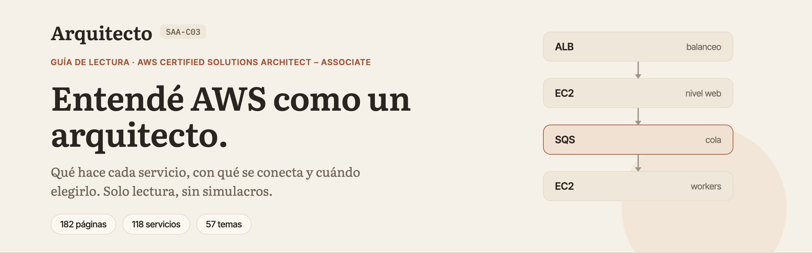
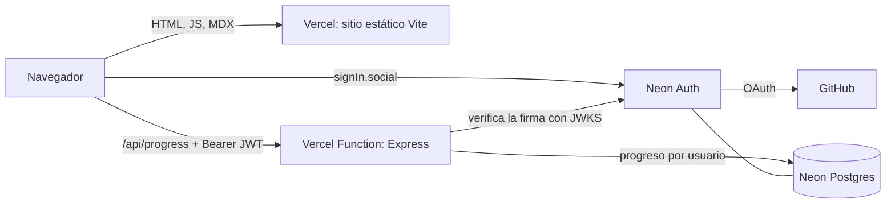

<p align="center">
  
</p>

<p align="center">
  <a href="https://aws-saa-study-site.vercel.app"><strong>aws-saa-study-site.vercel.app</strong></a>
</p>

# Arquitecto

Sitio de estudio **solo de lectura** para el examen **AWS Certified Solutions Architect – Associate
(SAA-C03)**. No tiene simulacros ni preguntas: explica qué hace cada servicio, qué problema
resuelve, con qué se conecta y cuándo conviene elegirlo, con el texto armado a partir de la guía
oficial del examen y de la documentación de AWS.

> No es material oficial de AWS. Es un proyecto personal de estudio.

## Contenido

- [Qué incluye](#qué-incluye)
- [Cómo está armado el contenido](#cómo-está-armado-el-contenido)
- [Arquitectura](#arquitectura)
- [Estructura del repositorio](#estructura-del-repositorio)
- [Correrlo en tu máquina](#correrlo-en-tu-máquina)
- [Inicio de sesión y progreso](#inicio-de-sesión-y-progreso)
- [Despliegue (Vercel + Neon)](#despliegue-vercel--neon)
- [Migraciones](#migraciones)
- [Calidad y convenciones](#calidad-y-convenciones)
- [Cómo se trabajó](#cómo-se-trabajó)
- [Limitaciones conocidas](#limitaciones-conocidas)

## Qué incluye

| Sección             | Qué vas a encontrar                                                                                        |
| ------------------- | ---------------------------------------------------------------------------------------------------------- |
| **Ruta guiada**     | El orden de la guía oficial: Fundamentos y los cuatro dominios del examen (30 %, 26 %, 24 % y 20 %).       |
| **Servicios**       | Los 118 servicios que la guía declara dentro del alcance, agrupados en sus 16 categorías.                  |
| **Arquitecturas**   | 57 temas transversales (seguridad, resiliencia, rendimiento y costos) que conectan los servicios entre sí. |
| **Mapa del examen** | Cada tarea de la guía enlazada con las páginas que la cubren, con tu avance.                               |
| **Glosario**        | Las siglas del examen con su definición y la fuente oficial.                                               |
| **Búsqueda**        | `⌘K` / `Ctrl+K`: busca servicios, siglas y texto, y salta directo a la sección.                            |
| **Progreso**        | Marcá cada página como leída. Se guarda por usuario cuando iniciás sesión con GitHub.                      |
| **Modo oscuro**     | Respeta el tema de tu sistema y te deja cambiarlo.                                                         |

En total son **182 páginas**: 7 de fundamentos, 57 de temas y 118 de servicios. Leer **no requiere
cuenta**: iniciar sesión solo suma guardar lo que ya leíste.

## Cómo está armado el contenido

- **Fuentes**: únicamente la guía de examen SAA-C03 y `docs.aws.amazon.com`. Todo explicado con
  palabras propias, en español, dejando los nombres de los servicios en inglés.
- **Cobertura**: cada punto de la guía (conocimientos y habilidades) está asignado al menos a una
  página; un test de cobertura lo valida.
- **Estructura de cada página**: qué problema resuelve, conceptos clave, cómo se conecta con otros
  servicios, cómo elegir (cuándo usarlo y cuál es la alternativa) y las fuentes oficiales.
- **Verificación de fuentes**: `node scripts/check-sources.mjs` comprueba que cada URL de
  `docs.aws.amazon.com` citada en las páginas siga respondiendo.
- **Sin invenciones**: lo que la documentación no dice se suaviza o se saca; no hay precios ni
  cifras que no estén en la fuente.

## Arquitectura

Un solo proyecto de Vercel sirve el sitio y la API desde el mismo origen. La base de datos y los
usuarios viven en Neon.



- **Web** (`apps/web`): React + Vite + TypeScript estricto. Rutas con TanStack Router, estado del
  servidor con TanStack Query, contenido en MDX, estilos con CSS Modules (BEM) y tokens de diseño.
- **API** (`apps/api`): Express 5 + Drizzle ORM + Postgres. Corre en Vercel como una Function y
  verifica el token de sesión con `jose` contra las claves públicas (JWKS) de Neon Auth.
- **Contratos** (`packages/contracts`): esquemas Zod compartidos entre la web y la API.
- **Diseño**: las pantallas se diseñaron primero en Penpot y después se implementaron.

## Estructura del repositorio

| Ruta                 | Para qué sirve                                                                           |
| -------------------- | ---------------------------------------------------------------------------------------- |
| `apps/web`           | Sitio Vite + React. El contenido vive en `apps/web/content` (páginas MDX y glosario).    |
| `apps/api`           | API Express que guarda el progreso por usuario en Postgres. Migraciones en `migrations`. |
| `api`                | Punto de entrada de la Vercel Function (`api/index.ts`).                                 |
| `packages/contracts` | Esquemas Zod compartidos por la web y la API.                                            |
| `scripts`            | Utilidades, como la verificación de fuentes.                                             |
| `odd`                | Documentos de cada funcionalidad: specs, tareas y bitácora de decisiones.                |
| `docs`               | Imágenes de la documentación.                                                            |

## Correrlo en tu máquina

Necesitás Node 22+, pnpm y Docker.

```bash
docker compose up -d --wait   # Postgres en localhost:5432
pnpm install

# Terminal 1: API en :3001
# Copiá apps/api/.env.example a apps/api/.env primero.
# Si ya tenías un .env viejo, agregale la línea NEON_AUTH_JWKS_URL del ejemplo.
pnpm --filter @arquitecto/api db:migrate
pnpm --filter @arquitecto/api dev

# Terminal 2: web en :5173 (hace proxy de /api hacia la API)
# Copiá apps/web/.env.example a apps/web/.env y completá VITE_NEON_AUTH_URL.
pnpm --filter @arquitecto/web dev
```

Abrí http://localhost:5173. **Leer funciona sin la API**; guardar el progreso sí la necesita.

## Inicio de sesión y progreso

Para leer no necesitás cuenta. Para guardar el progreso iniciás sesión con **GitHub** a través de
**Neon Auth** (Managed Better Auth sobre tu proyecto de Neon):

1. En `/acceso` tocás "Continuar con GitHub". El SDK (`@neondatabase/auth`, cliente vanilla) se
   carga recién ahí, fuera del paquete principal.
2. Neon Auth hace el intercambio OAuth con GitHub y te devuelve a la página desde la que venías.
3. Cada pedido a `/api/progress` lleva `Authorization: Bearer <JWT>` (el token de la sesión).
4. La API verifica la firma contra el JWKS (`NEON_AUTH_JWKS_URL`), toma el id de usuario del claim
   `sub` y lee o escribe **solo las filas de ese usuario**.

Sin un token válido, `/api/progress` responde `401 {"error":"unauthorized"}`.

La API acepta solo tokens firmados con una clave del JWKS usando `EdDSA` (el único algoritmo que
publica Neon Auth), con `exp` vigente y un `sub` no vacío. Neon Auth no documenta emisor ni
audiencia para sus tokens, así que la API **no** verifica `iss` ni `aud`.

### Configurar Neon Auth (una vez por rama de Neon)

Neon Auth ya está habilitado en la rama `production`; los usuarios viven en el esquema `neon_auth`
de la misma base. En **Neon Console > tu proyecto > la rama > Settings > Auth**:

1. **Trusted domains**: agregá cada origen donde corre el sitio (el dominio de Vercel y
   `http://localhost:5173` para desarrollo). El inicio de sesión solo redirige a esos orígenes.
2. **OAuth providers**: GitHub necesita tu propia aplicación OAuth. Creala en
   `github.com/settings/developers > OAuth Apps > New OAuth App` y registrá como **Authorization
   callback URL** `<URL base de Neon Auth>/callback/github`. Después pegá el Client ID y el Client
   secret en Neon, en **Add OAuth provider**.
3. **Registro con correo**: desactivá "Sign-up with Email" si no querés que se creen cuentas por
   fuera de GitHub.

Cada rama de Neon tiene su propia URL base de Auth, así que otra rama necesita su propio JWKS,
sus dominios de confianza y sus credenciales OAuth.

## Despliegue (Vercel + Neon)

Un único proyecto de Vercel sirve las dos partes desde el mismo origen:

- La web se compila con `pnpm --filter @arquitecto/web build` y se sirve desde `apps/web/dist`.
- `api/index.ts` exporta la app Express como una Vercel Function. `vercel.json` redirige `/api/*`
  a esa función y cualquier otra ruta cae en `index.html`.
- `packages/contracts` está escrito en TypeScript, pero la función corre JavaScript plano. Antes de
  empaquetarla, Vercel ejecuta el script raíz `vercel-build`, que compila los contratos a
  `packages/contracts/dist` (`pnpm --filter @arquitecto/contracts build`; ignorado por Git). Node
  resuelve el paquete a `dist` por la condición de export `node`; Vite, Vitest y los scripts de la
  API (`tsx --conditions=development`) siguen usando el código TypeScript.

### Variables de entorno

| Variable             | Dónde       | Valor                                                                             |
| -------------------- | ----------- | --------------------------------------------------------------------------------- |
| `DATABASE_URL`       | API         | Cadena de conexión **pooled** de Neon (el host termina en `-pooler`).             |
| `NEON_AUTH_JWKS_URL` | API         | `<URL base de Neon Auth>/.well-known/jwks.json` (claves públicas, no es secreto). |
| `DATABASE_POOL_MAX`  | API         | Opcional. Conexiones por instancia de la función; por defecto `1` en Vercel.      |
| `VITE_NEON_AUTH_URL` | Web (build) | URL base de Neon Auth, sin `/.well-known/...`. En Vercel va como tipo **Config**. |

Vite incrusta `VITE_NEON_AUTH_URL` al compilar: **sin esa variable el código de inicio de sesión
se descarta del build** y nadie puede entrar, así que redesplegá después de agregarla.

El SSL sigue a la cadena de conexión: `sslmode=require` (lo que te da Neon), `verify-ca` o
`verify-full` activan TLS verificado; sin `sslmode`, como en la URL de Docker local, no hay TLS.

### Primer despliegue

1. Creá un proyecto en https://console.neon.tech. En **Connect**, copiá dos cadenas de la misma
   base: la **pooled** (pooling activado, host con `-pooler`) para Vercel y la **directa**
   (pooling desactivado) para las migraciones.
2. Aplicá las migraciones en Neon desde tu máquina (ver abajo) con la cadena directa.
3. Importá el repositorio en https://vercel.com/new. Dejá el directorio raíz como está;
   `vercel.json` ya define el comando de instalación, el de build y el directorio de salida.
4. Antes de desplegar, cargá `DATABASE_URL`, `NEON_AUTH_JWKS_URL` y `VITE_NEON_AUTH_URL` en
   **Settings > Environment Variables** para Production (y Preview si lo usás).
5. Desplegá. El log del build tiene que mostrar `Running "pnpm run vercel-build"` y después
   `tsc -p tsconfig.build.json`; sin eso, la función no puede cargar los contratos.
6. Probá la API: `https://<tu-proyecto>.vercel.app/api/progress` tiene que responder
   `401 {"error":"unauthorized"}`. Abrí también un enlace profundo como `/lectura/amazon-s3` y
   recargá: el sitio tiene que cargar.
7. En el sitio, iniciá sesión y tocá "Marcar como leído" en cualquier página. Queda marcada solo
   para tu cuenta.

## Migraciones

`db:migrate` lee `DATABASE_URL` del entorno, y una variable ya seteada en el entorno gana sobre
`apps/api/.env`. Pegá la cadena **directa** de Neon en un prompt oculto para que no quede en un
archivo ni en el historial de tu shell:

```bash
read -rs DATABASE_URL && export DATABASE_URL   # pegá la cadena directa y Enter
pnpm --filter @arquitecto/api db:migrate
unset DATABASE_URL
```

Corrélo de nuevo después de cada migración nueva en `apps/api/migrations`, **antes** de desplegar
el código que la necesita.

La migración `0001_per_user_progress` agrega `read_pages.user_id` con la clave primaria
`(user_id, page_id)` y borra las filas de la época de un solo usuario, que no tienen dueño.
Drizzle aplica una migración solo si su `when` en `migrations/meta/_journal.json` es más nuevo que
el último `created_at` de `drizzle.__drizzle_migrations`; por eso una fila insertada a mano para
`0000` tiene que llevar el `when` de `0000` (`1793296802636`) o uno más viejo.

## Calidad y convenciones

```bash
pnpm lint && pnpm format:check && pnpm -r typecheck
pnpm --filter @arquitecto/web test
pnpm --filter @arquitecto/contracts test
pnpm --filter @arquitecto/api test # necesita `docker compose up -d --wait`
```

- TypeScript estricto (`noUncheckedIndexedAccess`, `exactOptionalPropertyTypes`), ESLint y Prettier.
- Tests con Vitest y Testing Library sobre el contenido real; la API se prueba contra un Postgres
  real, con tokens firmados por un par de claves generado en el propio test.
- Estructura por funcionalidades en `src/features`, archivos en `kebab-case`, funciones flecha con
  exports con nombre.
- Más detalle de las reglas del proyecto en `AGENTS.md`.

## Cómo se trabajó

Cada funcionalidad tiene un documento en `odd/tasks` con sus especificaciones (citando lo que se
pidió), las tareas y una bitácora de decisiones y límites. El flujo fue: explorar, diseñar en
Penpot cuando había pantallas nuevas, escribir los tests primero, implementar en tandas chicas
y verificar en un navegador real antes de subir. Lo que no se pudo comprobar quedó anotado en
esos mismos documentos.

## Limitaciones conocidas

- El texto de las páginas es una explicación propia y sigue sujeto a revisión: ante una duda,
  mandá a la fuente oficial que cada página cita al final.
- La API no verifica `iss` ni `aud` del token, porque Neon Auth no los documenta.
- El inicio de sesión depende de que el navegador acepte la cookie del servicio de Neon Auth, que
  vive en otro dominio.
- Si te quedás sin sesión o sin conexión con la API, el sitio sigue funcionando para leer; solo se
  pierde el guardado del progreso.
